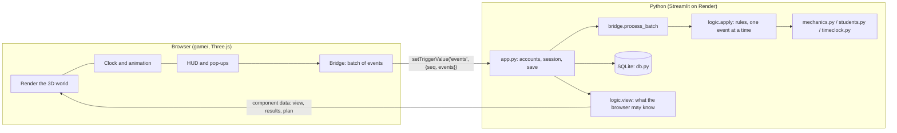

# Architecture: Python decides, the browser animates (v15)

This document explains how Nova Campus Tycoon is built: which part does what, how a player action travels through the system, how data is stored, how the game is hosted and why it was built this way. The rules themselves are explained in `docs/game-logic.md`; the tests in `docs/testing.md`.

## 1. The problem

Nova Campus Tycoon is a real-time 3D game: the player walks with the keyboard, the clock runs at up to 8x speed and up to 60 students move at the same time. The course, however, requires Python with Streamlit, SQLite for storage and pytest for the rules.

Streamlit reruns the whole Python script on every interaction and needs a round trip to the server for it. Python can therefore not draw 60 frames per second. At the same time the rules must be Python code, because only then can they be tested with pytest.

## 2. The decision

- **Python owns every rule and every decision.** The game state, all checks, the student utility model, purchases, stock and shelf life, serving, reputation, managers, the monopoly progression and the daily summary are pure Python (`logic.py`, `students.py`, `mechanics.py`, `timeclock.py`, `config.py`, `easter_eggs.py`). They have no Streamlit or browser code and are fully covered by pytest.
- **The browser only renders, animates and collects input.** The Three.js game in `game/` draws the campus, runs the clock, moves the figures, shows the HUD and the pop-ups and reports what happened as events ("the student reached the counter", "the player accepted the order", "the clock passed 08:00").
- **The bridge is a Streamlit v2 component** (`st.components.v2.component`, Streamlit 1.67). It stays mounted between reruns, so the 3D scene keeps running while Python answers.

## 3. How one action travels (request lifecycle)

Example: the player hands over an order.

1. **Browser:** the player presses Enter in the handover pop-up. `flow.js` calls `bridge.send("handover", {shop, student}, callback)`. The bridge stamps the event with a client id (`cid`), the game time `t` and the game day, and puts it into the outgoing batch.
2. **Browser to Python:** the bridge sends the waiting events (up to 60) as one batch `{seq, events: [...]}` with `setTriggerValue`. Only one batch is on its way at a time; new events wait in the outbox and go with the next batch as soon as the answer arrives. A batch without an answer after 4 s is sent again (Python ignores a `seq` it has already handled). Streamlit starts a rerun and first calls the callback `handle_events` in `app.py`.
3. **Python, `app.py`:** ignores a batch it has already seen (`seq`), handles login events itself (`auth_*`), and for game events loads the save of the logged-in player from SQLite.
4. **Python, `bridge.process_batch`:** migrates old saves, then calls `logic.apply(state, event)` for every event. `apply` checks the event type, moves the game time forward (never backwards), runs the handler on a copy of the state and returns the new state and a result. A forbidden event raises `GameError`; it changes nothing and its error message goes back to the browser. The other events of the batch still run.
5. **Python, `app.py`:** saves the new state (`db.save_game`) and keeps it for this run.
6. **Python, `payload()`:** builds the component data: `logic.view(state)` (only what the browser may know; student utilities stay secret), the results per `cid`, the day plan, the account and, once per session, the config and the lighting table.
7. **Browser:** `main.js` receives the data, the bridge calls the waiting callbacks with their results (for example a toast "Happy customer: +€4.20" and "+3 reputation"), and the HUD shows the new view.

A round trip takes about 45 ms locally and 150 to 400 ms on the hosted server (it runs in Oregon, USA). The browser never waits for a round trip to animate: figures keep walking and the clock keeps running while Python answers.

## 4. Python modules

| File | Lines | Role |
|---|---|---|
| `app.py` | ~190 | Streamlit page: hides Streamlit's own interface, mounts the game component, handles event batches, accounts and saving, builds the payload |
| `bridge.py` | ~25 | Runs a batch of browser events through `logic.apply`, one by one |
| `logic.py` | ~2,200 | The game state and all rules: 48 event handlers, stock, serving, reputation, managers, progression, day end, summary, objective, view |
| `mechanics.py` | ~670 | One class per shop mechanic (counter, vending, shelves, assembly, lunch rush, rental, sunset bar, melting) behind one interface |
| `students.py` | ~250 | Student pool, day schedule, state machine, utility model and decisions |
| `timeclock.py` | ~120 | Clock, speeds, day phases, lighting schedule |
| `easter_eggs.py` | ~130 | Jep and the casino (roulette, slots, bar) |
| `config.py` | ~660 | Every balancing value in one JSON-compatible dict (prices, shelf lives, shops, reputation, weather ...) |
| `db.py` | ~195 | SQLite storage: saves, users, login sessions |
| `auth.py` | ~70 | E-mail and password rules, password hashing, login tokens |
| `simulation.py` | ~300 | Headless driver that plays whole days and campaigns without a browser (tests and balancing) |

**The state** is one JSON-compatible dict (saved as one row). Its main keys: `seed`, `day`, `time`, `status` (running, victory, game_over), `day_state` (MORNING_PLANNING ... DAY_SUMMARY), `money`, `reputation`, `shops` (per shop: owner, prices, stock batches, front, mechanic data, manager, upgrades), `students` (per student: status, intent, budget, utilities), `schedule`, `plan`, `cart`, `bag`, `current_order`, `tray`, `manager_proposals`, `stats` (today's counters) and `history` (one summary per day).

**Events** (48 handlers in `logic.HANDLERS`), grouped:
- Day: `tick`, `next_day`, `resume`, `autosave`, `continue_open_mode`
- Planning and supplies: `confirm_plan`, `enter_wholesaler`, `set_cart_item`, `pay`, `leave_wholesaler`, `stock_goods`, `set_prices`, `open_shop`
- Students: `student_arrive`, `student_leave`, `decide`, `join_queue`, `queue_full`, `patience_expired`
- Serving: `at_counter`, `accept`, `reject`, `prepare`, `assemble`, `handover`, `checkout`, `discard_tray`, `cancel_order`, `auto_serve`
- Shops: `fill_front`, `refill_machine`, `collect_cash`, `deposit_cash`, `repair`, `manager_service`, `set_happy_hour`, `clean`
- Progression: `buy_upgrade`, `hire_manager`, `confirm_manager_plan`, `confirm_all_manager_plans`, `buy_shop`, `buy_competitor`
- Easter eggs: `buy_from_jep`, `enter_casino`, `roulette`, `slot`, `buy_drink`

**Mechanics as classes.** `mechanics.of(shop)` returns the mechanic object of a shop. All of them implement the same methods (is a product available, what does it cost now, demand factor, visit chance, objective text, start and end of the day, manager filling ...). `logic.py` calls these methods and never needs to know which shop it is. Adding a shop means adding config and, if needed, one mechanic class.

## 5. The browser (game/)

| File | Lines | Role |
|---|---|---|
| `game.html`, `game.css` | ~380 | HUD, pop-up layer, labels, minimap; one visual style |
| `js/core.js` | ~90 | Helpers and the bridge (`send`, `flush`, `receive`) |
| `js/world.js` | ~1,400 | The 3D campus: buildings, shops, stations, props, beach, walking grid (A* path finding), interactables |
| `js/people.js` | ~350 | Student, staff and player figures and their movement |
| `js/flow.js` | ~2,500 | The game flow: every pop-up (P00 to P47), objectives and markers, queues, serving, managers' walks, summary |
| `js/ui.js` | ~330 | HUD, dialogs and their queue, toasts, labels above heads |
| `js/main.js` | ~850 | Scene, camera, lighting, input, main loop, minimap, big map, saving triggers |
| `js/eggs.js` | ~830 | Jep and the casino in 3D |
| `js/sound.js` | ~230 | Music and sound effects (generated with the Web Audio API) |

The browser keeps only presentation state: positions, walking paths, animation, camera, timers for progress bars and patience. If Python rejects an event, the browser shows the error and changes nothing.

## 6. Determinism and fairness

- Every random decision in Python uses a generator seeded with the game seed, the day, the student and (where needed) the game time. The same day therefore produces the same purchases at 1x and at 8x (`tests/test_students.py::test_same_purchases_at_1x_and_8x`).
- Student utilities never leave Python (`logic.view` leaves them out), so the browser cannot read what a student will buy.
- Events of a previous day (an autosave sent at 21:00 while the next day loads) keep their effect but cannot move the new day's clock (v11).

## 7. Storage (SQLite)

`db.py`, tables:

| Table | Columns | Purpose |
|---|---|---|
| `saves` | id, day, money, reputation, status, state_json, backup_json, user_id, updated_at | One row per game; `state_json` is the whole state, `backup_json` the previous good one |
| `users` | id, email (unique, case-insensitive), password_hash, created_at | Accounts |
| `sessions` | token_hash, user_id, expires_at | Login tokens (only their SHA-256 hash is stored) |

- SQLite runs in WAL mode with full sync. Every save keeps the previous state as a backup; if a state cannot be read, the backup is used, and a damaged database file is moved aside and replaced (v8).
- The integrity check and the schema update run once per database file and server process (v14).
- On the server the database lives on a persistent disk (`NCT_DB_PATH=/var/data/game.db`), so accounts and saves survive deploys.

## 8. Accounts and security

- Passwords are hashed with PBKDF2-SHA256, a random 16-byte salt and 200,000 rounds (`auth.hash_password`); comparing uses a constant-time check. Nobody, including the team, can read a password back.
- After login the browser keeps a random token (`secrets.token_urlsafe`); the database stores only its SHA-256 hash and an expiry date.
- A wrong password waits 0.5 s before answering, which slows down guessing.
- Every save belongs to one account; a player can only load his own games.

## 9. Performance

- **No dimming during answers (v15).** Streamlit marks an element as "stale" while Python runs longer than 0.5 s and fades it to 33 % opacity. The whole game is one element, so on a slow answer the screen turned into a dark blue film and jumped back: the flicker players saw. `app.py` sets the opacity of stale elements to 100 %.
- **Fewer bytes per answer (v14).** Config and lighting table are sent once per session; the view contains only the summary fields of the last days.
- **Less work per answer (v14).** The state handled in a run is not loaded twice; the database check runs once per process.
- **Lighter rendering (v14).** At most 1.25 render pixels per screen pixel, PCF shadows, at most 60 frames per second (30 when nothing moves). The sun and the shadow area move in steps, so shadow edges do not shimmer.

## 10. Hosting

- Render web service (Python runtime), branch of the current version. Build: `uv sync --frozen && uv cache prune --ci`. Start: `uv run streamlit run app.py --server.port $PORT --server.address 0.0.0.0 --server.headless true`.
- Persistent disk at `/var/data` with the database.
- Domain `www.novacampustycoon.com` (Namecheap DNS to Render).
- Each version is a Git branch (v2 ... v15); Render deploys the branch it is set to.

## 11. Why this is the simplest solution that animates smoothly

- One event round trip is fast enough for decisions, because events are batched and the browser never waits for them to animate.
- The alternatives were worse: running the simulation in Python per frame (Streamlit reruns are far too slow for 60 frames per second), or writing the rules in JavaScript (they could not be tested with pytest and would drift apart from Python).
- The browser keeps a tiny copy of the clock formula only for smooth display; the tested rule is `timeclock.advance`, and every effect of time (opening, closing, spoilage) happens in Python on the ticks.
